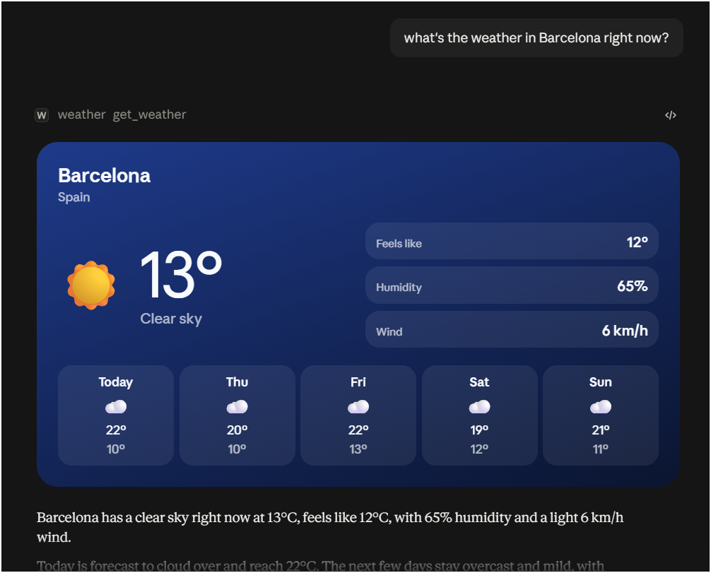

# ts-mcp-weather

A small [MCP](https://modelcontextprotocol.io) server that answers questions like *"What's the weather in Šiauliai?"* with a weather card rendered right in the chat.

It exposes one tool, `get_weather`, and links it to an [MCP App](https://github.com/modelcontextprotocol/ext-apps) UI resource. Hosts that support MCP Apps show the card; other hosts still get a short text summary.


<!-- TODO: add a screenshot of the widget at docs/screenshot.png -->

## What it does

```
city name ──► Open-Meteo geocoding ──► Open-Meteo forecast ──► text summary + structured report ──► weather card
```

- **Tool:** `get_weather({ city: string })`
- **Data:** [Open-Meteo](https://open-meteo.com) geocoding and forecast APIs (free, no API key), metric units
- **Card:** city and country, current temperature, condition, feels-like, humidity, wind, and a 5-day forecast
- **Theming:** follows the host's light/dark theme, and the gradient changes with the weather
- **Errors:** an unknown city or a network problem returns a clear message instead of crashing

## Requirements

- Node.js 22 or newer
- pnpm

## Install and build

```bash
pnpm install
```

```bash
pnpm build
```

The build writes two things to `dist/`:

- `dist/mcp-app.html`: the widget, bundled into a single file by Vite and `vite-plugin-singlefile`
- `dist/server/`: the compiled server

## Run

```bash
pnpm start
```

The server speaks MCP over stdio, so it waits for a client on stdin. Logs go to stderr only, because stdout carries the protocol.

## Test

```bash
pnpm test
```

```bash
pnpm typecheck
```

The tests cover the weather-code mapping, response parsing and error handling, with HTTP calls mocked.

## Add it to Claude

Build the project first, then point the client at the absolute path of `dist/server/index.js`.

### Claude Desktop

Add this to `claude_desktop_config.json` (Settings → Developer → Edit Config) and restart Claude Desktop:

```json
{
  "mcpServers": {
    "weather": {
      "command": "node",
      "args": ["/absolute/path/to/ts-mcp-weather/dist/server/index.js"]
    }
  }
}
```

### Claude Code

```bash
claude mcp add weather -- node /absolute/path/to/ts-mcp-weather/dist/server/index.js
```

Then ask: *"What's the weather in Šiauliai?"*

## Project structure

```
mcp-app.html                  Widget markup (Vite entry)
src/
  shared/weather-report.ts    Report schema shared by the tool output and the widget
  server/
    index.ts                  Entry point: stdio transport
    server.ts                 Creates the MCP server
    weather-tool.ts           get_weather tool and error handling
    widget-resource.ts        ui:// resource serving the bundled widget
    weather-service.ts        city → geocoding → forecast → report
    summary.ts                Plain-text summary
    weather-codes.ts          WMO weather code lookup
    errors.ts                 Domain errors
    open-meteo/               HTTP client, geocoding and forecast
  ui/
    mcp-app.ts                Connects the widget to the host
    host-theme.ts             Applies host theme, fonts and insets
    render-card.ts            Renders the report into the card
    format.ts                 Display formatting
    styles.css                Card styles
tests/                        Vitest tests
```

## Built with

[MCP TypeScript SDK](https://github.com/modelcontextprotocol/typescript-sdk), [MCP Apps (`ext-apps`)](https://github.com/modelcontextprotocol/ext-apps), [zod](https://zod.dev), [Vite](https://vite.dev) and [Vitest](https://vitest.dev).
